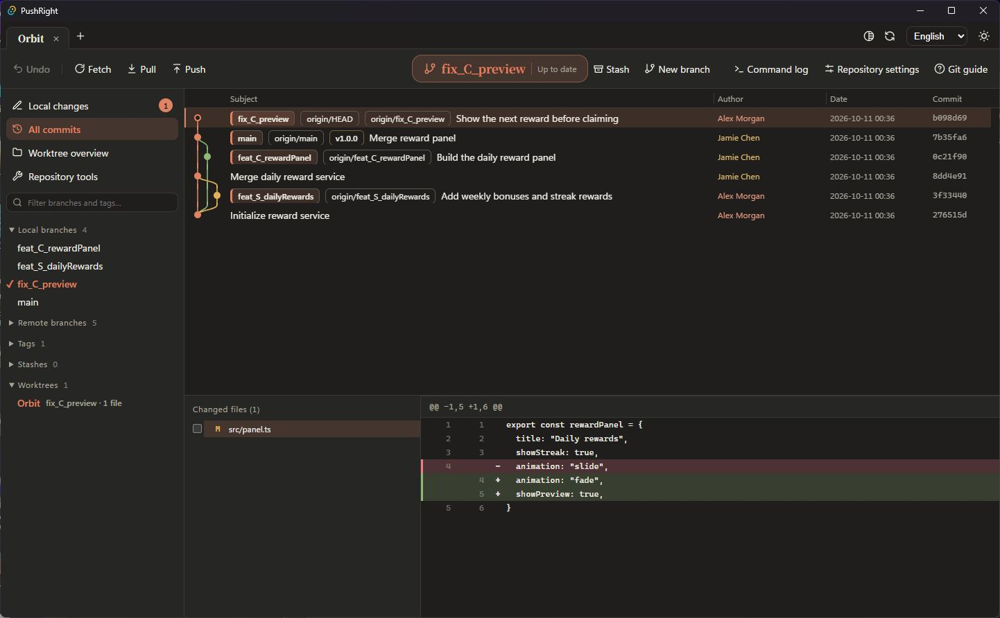
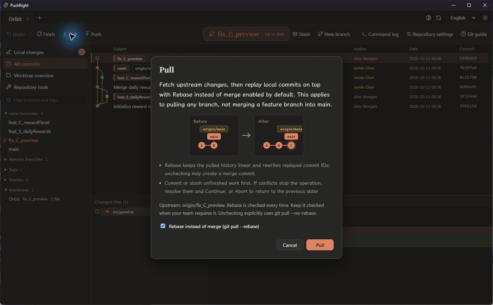

# PushRight

**See your branches. Push to the right place.**

[English](README.md) · [简体中文](README.zh-CN.md)

A Git desktop client built with Svelte, Tauri and Rust. PushRight makes push destinations explicit, recommends a remote branch with the same name, and defaults Pull to **Rebase instead of merge**.

## Why PushRight

1. **Pushes go to the right place.** Every push states its remote and branch. When the local branch and its upstream have different names, PushRight asks you to choose and recommends the same-name remote branch. Force push uses `--force-with-lease --force-if-includes`.
2. **The Git command sits next to the action.** In the Chinese interface, menus, dialogs and buttons append the command they run; toolbar buttons show it in the tooltip. The command log lists every command executed and its output, so you learn what to type in a terminal.
3. **Consequences are explained before you confirm.** Merge, rebase, reset, discard and similar operations describe the outcome in plain language, with before/after diagrams and recovery advice. Some operations offer one-click undo.
4. **Color-vision-friendly diffs.** Blue / Orange, Purple / Gold and Cyan / Rose presets, or independent custom added/deleted colors. Diff lines keep + / − signs and borders, so color is never the only cue. The extension applies the same palette to native VS Code / Cursor diffs.
5. **One extension instead of several.** The VS Code / Cursor extension combines source control, end-of-line authorship, whole-file blame, CodeLens, file history, line history, previous / next revision, comparison with any revision, commit search and the commit graph.
6. **Automatic refresh and fetch.** The desktop app refreshes open repositories every minute and fetches when they open and every ten minutes, including background tabs. It updates remote refs only: no automatic pull, merge or working-file changes. Each can be turned off.
7. **Pull rebases by default.** Every Pull asks, with **Rebase instead of merge** checked.
8. **Conflicts are resolved block by block.** Ours and theirs appear side by side for each conflict; in-progress operations can be continued or aborted at any time.
9. **Worktrees and repository tools.** Worktree overview, arbitrary revision comparison, reviewed-file marks, remote URLs, interactive rebase and reflog recovery are available in the interface.
10. **Works on large repositories.** Measured on a Linux repository with 1.48 million commits and a 128 MiB file; see the [performance report (Chinese)](docs/PERFORMANCE.md).
11. **English and Simplified Chinese, light and dark themes**, with individual author styles.
12. **The desktop app and extension share one engine and interface.** The extension includes its own engine and does not require the desktop installation. MIT licensed.

The extension updates automatically when installed from VS Code Marketplace. The desktop app has no automatic updates yet; download the installer for each new version.

## This release

Version **1.1.11** adds a global time-zone selector to the desktop app and extension, plus repository statistics, commit assistance, external diff/merge tools and an extension Worktrees view. It also expands graph filtering, branch management and conflict editing. See the [release notes](docs/RELEASE_1.1.11.md).

Choose **System time zone**, **UTC** or a region such as **Asia/Shanghai** in the top-right time-zone dropdown. In VS Code / Cursor, open **PushRight: Open Commit Graph** to find it. The setting applies to every repository in that app, including commit details, history, blame, worktrees and the dates and months in repository statistics. Changes apply immediately and survive restarts; daylight saving follows each commit's date. The desktop app and each editor store their preferences separately.

Chinese action labels append native Git commands across menus, dialogs, buttons and extension commands; toolbar buttons show the name only, with the command in the tooltip. **Repository settings**, available in the desktop toolbar and extension Source Control menu, can disable revert for the local repository. Both apps and linked worktrees share `pushright.disableRevert` in the local Git config; other repositories are unaffected. Revert remains allowed by default. When disabled, PushRight blocks starting or continuing revert while allowing abort. Terminal Git and other tools are outside this setting's scope.

The desktop app refreshes open repositories every minute and fetches when they open and every ten minutes, including background tabs. Both defaults can be disabled independently in **Automatic refresh and fetch** beside the language selector. Busy repositories defer work; failures appear in the command log and retry on schedule. Background fetch preserves `FETCH_HEAD`, the index and working files. Force push also uses `--force-if-includes` to protect remote commits fetched in the background. These timers run while the desktop app is open, not after it exits; the extension does not enable them.

**v1.1.11 (MIT licensed)** is available for Windows x64. It starts in English and includes complete English and Simplified Chinese UI packs. Switch languages in the top-right corner; your choice is remembered.

The desktop client and editor extension share the new repository tools. The extension includes its own engine and does not require the desktop installation.



Screenshots show the actual 1.1.10 desktop app with a local demo repository and fictional identities. The extension shares this full graph interface.

Source code for this release is available as [ZIP](https://github.com/ArthurLauCS/PushRight/archive/refs/tags/v1.1.11.zip) or [tar.gz](https://github.com/ArthurLauCS/PushRight/archive/refs/tags/v1.1.11.tar.gz).

## Download and install

**[Download desktop installer](https://github.com/ArthurLauCS/PushRight/releases/download/v1.1.11/PushRight_1.1.11_x64-setup.exe)** · **[Download VSIX (VS Code / Cursor)](https://github.com/ArthurLauCS/PushRight/releases/download/v1.1.11/pushright-win32-x64-1.1.11.vsix)** · [SHA256 checksums](https://github.com/ArthurLauCS/PushRight/releases/download/v1.1.11/SHA256SUMS.txt)

Download `PushRight_1.1.11_x64-setup.exe` from [GitHub Releases](https://github.com/ArthurLauCS/PushRight/releases/tag/v1.1.11).

- Windows 10 / 11 x64; built and checked on Windows x64.
- Install [Git for Windows](https://git-scm.com/downloads/win) and make `git` available on PATH.
- Microsoft Edge WebView2 Runtime is required; the installer attempts an online installation if missing.
- The installer offers English and Simplified Chinese. App language is selected independently.
- The installer is unsigned; Windows may show an unknown-publisher prompt. Verify against the release's `SHA256SUMS.txt` using `Get-FileHash .\PushRight_1.1.11_x64-setup.exe -Algorithm SHA256`.

Previously named GitGod. PushRight retains the application data identifier for settings compatibility. The old GitGod installation may remain separately installed; it is not removed automatically.

Configure your identity in Git or edit it per repository in the app:

```sh
git config --global user.name "Your Name"
git config --global user.email "you@example.com"
```

PushRight uses system Git credentials or SSH configuration. Complete authentication in a terminal first if needed; the app does not provide account sign-in or interactive terminal prompts.

New branch names in the creation dialogs must match `(fix|feat)_(S|C|SC)_lowerCamelCase`, for example `feat_S_userLogin` or `fix_SC_branchPicker`. The suffix starts with a lowercase letter and contains only ASCII letters and digits. The desktop new-branch dialog and editor picker let you choose a starting branch; the desktop new-worktree dialog also validates new branch names. Existing branch names are unaffected.

## Usage

Open a local repository, or pass its path when launching:

```powershell
& "C:\path\to\pushright.exe" "C:\path\to\repository"
```

### Diff colors

The toolbar’s **Diff Colors** dialog offers Blue / Orange, Purple / Gold and Cyan / Rose presets, independent added/deleted color pickers, HEX input and a live preview. Preferences persist locally; **Restore original colors** follows the app theme again. Diff lines retain + / − markers and colored borders.

### Commit and push

1. Review changes, stage files, hunks or selected lines, and enter a commit message.
2. Check the remote and branch before pushing. When a branch name differs from its upstream, the app requires an explicit choice and recommends the same-name remote branch.
3. Push uses an explicit remote and branch refspec. Force push uses `--force-with-lease --force-if-includes`; check the destination and expected effect first.

For example, if local `feature/login` accidentally tracks `origin/main`, the dialog recommends `origin/feature/login` and makes the mismatch visible.

### Pull with Rebase instead of merge

Click **Pull**. The dialog shows the upstream and checks **Rebase instead of merge** every time, even if the previous pull used merge. The dialog cannot be skipped with “Don't show again.”

- Checked: explicitly runs `git pull --rebase`, overriding `pull.rebase=false` and branch-level merge preferences.
- Unchecked: explicitly runs `git pull --no-rebase`, which may create a merge commit. Keep the box checked when your team requires it.
- Commit or stash unfinished work first. Automatic stashing and updates to other local branch refs are disabled for this operation.
- On conflicts, resolve and **Continue**, or **Abort** to restore the previous local state. During rebase, “ours” is upstream plus commits already replayed; “theirs” is the local commit being replayed.



This is a **pull strategy** for any current branch. It does not determine how a feature branch merges into `dev`, `main` or `master`, or approve a hosted PR/MR. Follow the repository's separate merge policy. Rebase rewrites replayed commit IDs; coordinate before rewriting shared history. See the [Git pull reference](https://git-scm.com/docs/git-pull).

### Individual author styles

Right-click an author to set that person's background and border. Styles use the raw email, falling back to the name only when email is absent. Identical names with different emails remain separate. Settings are saved locally across repositories.

Left-click an author to highlight their commits temporarily. Keyboard users can focus an author and press `Shift+F10` to open styling.

### Commit identity

The **Local changes** commit panel shows the effective Git name and email. **Edit identity** saves repository-level `user.name` and `user.email`, without changing global configuration or existing commits. Linked worktrees share repository configuration.

The app reports effective identities and overrides from environment variables, `author.*`, `committer.*` or worktree configuration. Amending preserves the original author; the panel shows the current committer.

### Large repositories and files

The initial view loads 2,000 commits; full history follows in the background. The graph uses a compact skeleton, checkpoints every 1,024 rows and visible-window metadata. Existing branch switches and ref renames reuse the graph when the set of starting commit IDs stays unchanged.

Editable diff reads retain at most 4 MiB + 1 byte. Larger patches or previews beyond 5,000 lines offer read-only pages of 1,000 lines; lines beyond 64 KiB are clipped with a notice. Whole-file staging and commits remain available.

Measurements on a local Linux repository with 1.48 million commits and a 128 MiB file, including scope and reproduction commands, are in the [performance report (Chinese)](docs/PERFORMANCE.md).

### Included features

- Multiple repository tabs, recent repositories and session restoration.
- Virtualized graph, branches, tags, commit details and file diffs.
- Stage, unstage, commit and amend; file, hunk and selected-line operations.
- Create, switch, rename and delete branches; merge, rebase, cherry-pick, revert, reset and tags.
- Fetch, explicit Pull mode, destination-aware Push and stashes.
- Worktrees, conflict resolution, Continue and Abort.
- Repository tools: arbitrary revision/branch and merge-base comparisons, reviewed files, remote URLs, interactive rebase and reflog recovery.
- Before/after PNG/JPEG/GIF/WebP/BMP/ICO previews; clone and initialize from the welcome page.
- English / Simplified Chinese, light / dark themes, resizable panels, individual author styles, operation explanations and command logs.

App text, tooltips, explanations and app-generated errors are translated. Repository content, commit messages, branch names and raw Git/OS output stay verbatim. Native OS dialogs use the system language.

## VS Code / Cursor extension

Extension **1.1.11** includes inline commit file lists and native diffs, Auto / All / branch filters, same-name push from the graph, submodule discovery, a fixed-order branch list with the checked-out branch ticked, and batch local ignore / tracking controls.

The same engine and interface run inside VS Code. Install the Windows x64 extension from [VS Code Marketplace](https://marketplace.visualstudio.com/items?itemName=AthurLau.pushright) or download the VSIX from [GitHub Releases](https://github.com/ArthurLauCS/PushRight/releases/tag/v1.1.11). See the [extension guide](extension/README.md) for requirements and limits. To build from source:

```sh
npm ci
npm run ext:package
code --install-extension extension/pushright-win32-x64-1.1.11.vsix
```

- **Source Control panel**: staged, unstaged and conflicted files; stage, unstage or discard files or selected lines; commit and amend; gutter change markers and Explorer badges. On first use PushRight explains what turning off VS Code's built-in Git means and lets you decide.
- **Push and pull checks**: Pull asks every time with **Rebase instead of merge** checked. Push recommends the same-name remote branch when the upstream has a different name, and the status bar warns about the mismatch. Force push uses `--force-with-lease --force-if-includes` and asks twice.
- **Authors in the editor**: author, date and subject at the end of the current line, with a hover card; whole-file blame (`Alt+B`) colored by author or by age; CodeLens above files, classes and functions; a status bar item. Author styles set in the commit graph also apply here, and "Highlight Only This Line's Author" marks that author's lines in the file and scrollbar.
- **History**: file history that follows the active editor, line history for a selection, previous / next revision (`Alt+,` / `Alt+.`), compare with any branch, tag or commit, and commit search by message, author, file, changed text or ID.
- **Commit graph**: "PushRight: Open Commit Graph" opens the desktop interface in an editor tab.

Not included yet: macOS, Linux and remote (WSL / SSH) builds, PR / Issue integration. Submodules must already be initialized.

## Current limits

- PR / Issue and hosting-provider collaboration are not delivered yet.
- Visible rows are virtualized, but complete history is still read in the background.
- Large patches offer read-only pages that rescan the Git stream; Git may still consume time and memory before producing output. Partial staging/discard remains limited to 4 MiB patches.
- The graph has at most 24 lanes, reduced by available width. Highly parallel histories can omit connections.
- No automatic updates or macOS / Linux installers yet.
- Undo covers some local operations, not every Git action. Check prompts before destructive operations.

## Development

Requires Node.js 24, Rust stable, MSVC C++ tools and Windows SDK. See [Tauri prerequisites](https://v2.tauri.app/start/prerequisites/).

```sh
npm ci
npm run desktop:dev
```

`npm run dev` starts only the frontend; Git operations require the desktop backend.

```sh
npm run check
npm test
cargo test -p engine
npm run desktop:build
npm run ext:build   # VS Code extension: engine sidecar, panel and host
npm run ext:smoke   # runs the extension inside a throwaway VS Code profile
```

The installer is written to `target/release/bundle/nsis/`. The first build may download dependencies and NSIS tools. See [Tauri Windows installers](https://v2.tauri.app/distribute/windows-installer/).

| Path | Responsibility |
| --- | --- |
| `src/` | Svelte UI, graph and operation workflows |
| `src/lib/locales/` | English and Simplified Chinese packs |
| `crates/engine/` | Rust Git engine: gix reads and Git CLI operations |
| `crates/sidecar/` | The engine as a child process for the VS Code extension |
| `extension/` | VS Code extension: source control, blame, history and the commit graph panel |
| `src-tauri/` | Desktop window, command bridge and installer |
| `tests/` | Frontend regression checks |

## Feedback and licenses

Report problems in [Issues](https://github.com/ArthurLauCS/PushRight/issues) with the version, OS, reproduction steps and relevant logs. Remove credentials and private repository information before sharing logs.

Third-party notices are in [THIRD_PARTY_NOTICES.txt](THIRD_PARTY_NOTICES.txt) and included in the installation. PushRight is licensed under the [MIT License](LICENSE).
