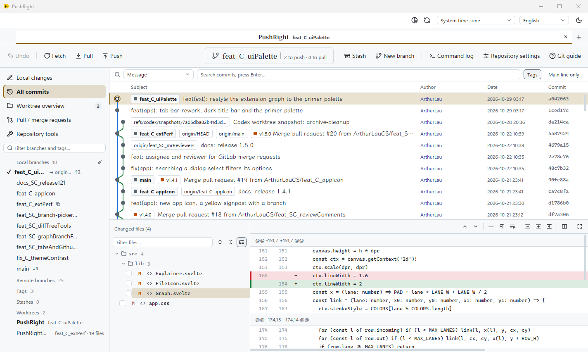

# PushRight

[English](README.md) · [简体中文](README.zh-CN.md)

面向多分支日常工作的 Git 桌面可视化客户端，用 Rust 编写，界面由 GPU 直接绘制（gpui），不依赖网页内核。

## 为什么用 PushRight

1. **推送不会推错地方**。每次推送都写明目标远程和分支；本地分支与 upstream 名字不一致时要求明确选择，并优先推荐同名远程分支。强制推送使用 `--force-with-lease --force-if-includes`。
2. **操作旁边就是 Git 命令**。中文界面的菜单、弹窗和按钮在名称后附带实际执行的 Git 命令，工具栏按钮的命令在悬停提示里；命令日志显示执行过的每条命令及其输出。边用边学，离开 PushRight 也知道终端里该敲什么。
3. **操作之前先讲清后果**。合并、变基、重置、丢弃等操作在确认前用白话说明会发生什么，配操作前后的示意图和「做错了怎么办」；部分操作提供一键撤销。
4. **色觉友好的差异配色**。蓝／橙、紫／金、青／玫红三组预设，也可分别自定义新增、删除颜色；差异行同时保留 + / − 标记和边框，不只靠颜色区分。扩展里同一套配色也应用到 VS Code / Cursor 原生 diff。
5. **一个扩展顶多个**。VS Code / Cursor 扩展集成了源代码管理、行末作者信息、整文件 Blame、CodeLens、文件历史、行历史、上一版／下一版对比、与任意版本对比、提交搜索和提交图，不必分别安装多个扩展再逐个配置。
6. **自动刷新与获取**。桌面版每分钟刷新已打开的仓库，打开时及之后每十分钟自动 fetch，后台页签同样生效；只更新远程引用，不自动 pull、合并或改动工作区文件。两项可分别关闭。
7. **拉取默认变基**。每次 Pull 都询问并默认勾选「变基而非合并」，减少无意义的合并提交。
8. **冲突逐处解决**。冲突文件按冲突块并排显示我方和对方，逐处选择保留哪边；一边删除的文件、子模块和二进制文件整个取一边；进行中的操作随时可以继续或中止。
9. **工作树和仓库工具**。工作树总览、任意版本比较、文件审阅标记、远程地址管理、交互式变基和 Reflog 恢复都在界面里完成。
10. **大仓库可用**。在 148 万提交的 Linux 仓库和 128 MiB 文件上实测，数据见[性能记录](docs/PERFORMANCE.md)。
11. **中英双语、深浅主题**，可为每个作者单独设置显示样式。
12. **桌面版与扩展共用同一套引擎**，扩展自带引擎；扩展的「打开提交图」会打开桌面版；MIT 开源。

扩展通过 VS Code Marketplace 安装时由编辑器自动更新；桌面版暂无自动更新，新版本需重新下载安装包。

## 本版更新

**1.6.1** 修复冲突视图。有长行的文件不再把冲突面板和按钮撑出窗口。一边删除一边修改、改名和子模块引起的冲突会显示两边，可以整个取一边解决，选删掉的那边就删除文件。NUL 字节靠后的文本文件、以 `<<<<<<<` 开头的普通行都能正确读取；「工作区是干净的」提示不再压住筛选框。详见[发行说明](docs/RELEASE_1.6.1.md)。

**1.6.0** 重新设计了桌面版的外观：更扁平、配色更克制，每种用途一种字体（界面 Segoe UI Variable Text，标题 Noto Serif SC，正文 LXGW WenKai，代码 Cascadia Code），仓库页签带底线和新建页签按钮，标题栏随主题变为深色。扩展里的提交图用了同一套配色。详见[发行说明](docs/RELEASE_1.6.0.md)。

**1.5.0** 新建 GitLab 合并请求时可以选指派人和审核者：指派人默认是自己，审核者默认是这个项目上次指派的人，指派过的审核者排在前面。打开的合并请求可以修改或去掉审核者，概览里显示当前的审核者。对话框里的长下拉框（目标分支、项目成员等）输入文字就能筛选。详见[发行说明](docs/RELEASE_1.5.0.md)。

**1.4.1** 换了桌面版的应用图标：黄色向右的箭头路牌，上面画一条分支，在任务栏里不再和作者的其他应用相像。其他功能不变。详见[发行说明](docs/RELEASE_1.4.1.md)。

**1.4.0** 为拉取 / 合并请求加入行评论：在差异的行号上拖选几行就能评论，已有的评论显示在对应行下面。GitLab 上合并请求指定了审核者而你不在其中时，批准、评论、合并或关闭前会先提醒，仍然可以继续。禅模式让文件列表和差异铺满窗口，拉取 / 合并请求列表可以拖动调宽。详见[发行说明](docs/RELEASE_1.4.0.md)。

**1.3.0** 新增「拉取 / 合并请求」页，支持 GitHub 和 GitLab（含自建服务器）：筛选列表，查看说明、CI 检查、审阅、提交和改动文件，再检出、合并、批准、关闭，或从分支新建。分支和文件等长列表只渲染看得见的行，几万个提交、上千个分支的仓库也流畅。滚动条常驻，差异底部的横向滚动条不再挡住最后一行，页签上的仓库名和分支名居中加粗。详见[发行说明](docs/RELEASE_1.3.0.md)。

**1.2.1** 让仓库页签单独占一行、按数量平分宽度：可拖动排序，双击或右键可自定义名字，页签上显示当前分支，同一仓库开多个工作树时一眼分清。侧栏列出 GitHub 拉取请求及审阅、检查状态，可在应用里创建、检出和合并。差异文本可以选中复制，差异配色改为取色器并实时预览。详见[发行说明](docs/RELEASE_1.2.1.md)。

**1.2.0 正式版**用 Rust 重写桌面版，界面改由 GPU 直接绘制，不再使用 Tauri 网页内核；外观、布局、功能和中英双语保持不变。同一台机器上打开仓库约 0.5–0.7 秒，只占 1 个进程、约 124 MB 内存（原来 7 个进程、约 415 MB），也不再需要 WebView2。详见[发行说明](docs/RELEASE_1.2.0.md)。

VS Code／Cursor 中的 **PushRight: 打开提交图** 和 **在提交图中定位** 改为用桌面版打开仓库，桌面版已在运行时直接切换过去；VSIX 从 13 MB 减到 1.7 MB。日期时区改用 **PushRight: 时区…** 选择。

在桌面版右上角时区下拉框中选择“跟随系统时区”、`UTC` 或 `Asia/Shanghai` 等地区。设置对当前应用中的所有仓库生效，覆盖提交详情、历史、Blame、工作树及仓库统计的日期和月份；立即刷新并在重启后保留，按提交日期自动处理夏令时。桌面版和各编辑器分别保存偏好。

中文操作名称附带对应 Git 命令，覆盖菜单、弹窗选项、按钮和扩展命令面板；工具栏只显示名称，命令在悬停提示里。桌面版顶部和扩展的源代码管理菜单均提供“仓库设置”，可禁用当前仓库中的 revert。设置保存在本地仓库配置 `pushright.disableRevert`，两端及关联工作树共用，不影响其他仓库；默认不禁用。启用后 PushRight 拒绝发起或继续 revert，仍可中止。此设置不限制终端或其他 Git 工具。

桌面应用每分钟刷新所有已打开的仓库，打开仓库时及之后每十分钟自动 fetch，后台页签也生效。两项默认开启，可在语言选择框旁的“自动刷新与获取”中分别关闭。仓库忙碌时延后执行，失败写入命令日志并按周期重试；后台 fetch 保留 `FETCH_HEAD`、暂存区和工作区文件。强制推送增加 `--force-if-includes` 检查，防止覆盖后台刚获取但未在本地整合的远端提交。应用退出后不执行定时任务，扩展版不启用这些定时器。

当前版本为 **v1.6.1 正式版（MIT 许可）**，提供 Windows x64 安装包。首次启动默认英文，内置完整英文和简体中文语言包，可在右上角切换，选择会保存在本机。界面、提示、操作说明和应用自身的错误均提供双语；仓库内容和 Git / 系统原始输出保持原文，系统原生对话框使用系统语言。



第一张截图来自 1.6.0 桌面程序，打开的是 PushRight 自己的仓库；另一张来自 1.2.0，使用虚构作者和本地示例仓库。

本版源码：[ZIP](https://github.com/ArthurLauCS/PushRight/archive/refs/tags/v1.6.1.zip) · [tar.gz](https://github.com/ArthurLauCS/PushRight/archive/refs/tags/v1.6.1.tar.gz)。

## 下载与安装

**[下载桌面安装包](https://github.com/ArthurLauCS/PushRight/releases/download/v1.6.1/PushRight-Setup-1.6.1.exe)** · **[下载 VSIX（VS Code / Cursor）](https://github.com/ArthurLauCS/PushRight/releases/download/v1.2.0/pushright-win32-x64-1.2.0.vsix)** · [SHA256 校验值](https://github.com/ArthurLauCS/PushRight/releases/download/v1.6.1/SHA256SUMS.txt)

从 [GitHub Releases](https://github.com/ArthurLauCS/PushRight/releases/tag/v1.6.1) 下载 `PushRight-Setup-1.6.1.exe`，运行安装程序。安装到当前用户的 `%LOCALAPPDATA%\Programs\PushRight`，不需要管理员权限。

- 支持 Windows 10 / 11 x64；本次发布在 Windows x64 上构建和验证。
- 需要安装 [Git for Windows](https://git-scm.com/downloads/win)，并确保 `git` 在 PATH 中可用。
- 安装包尚未进行代码签名，Windows 可能显示未知发布者提示。Release 附有 `SHA256SUMS.txt`，可用 PowerShell 的 `Get-FileHash .\PushRight-Setup-1.6.1.exe -Algorithm SHA256` 核对文件。

安装器支持英文和简体中文，应用语言独立选择。从 1.1.x 升级时会自动卸载旧版。偏好保存在 `%APPDATA%\PushRight\settings.json`；1.1.x 的语言、主题、时区、差异配色、作者样式和最近仓库不会迁移，需要重新设置一次。

首次使用前，在 Git 中配置提交身份及远程认证：

```sh
git config --global user.name "Your Name"
git config --global user.email "you@example.com"
```

PushRight 使用系统 Git 的凭据管理器或 SSH 配置；遇到认证失败，先在终端完成相应仓库的 Git 认证。应用本身不提供账号登录或交互式终端提示。

新建分支对话框中的名称须符合 `(fix|feat)_(S|C|SC)_小驼峰`，例如 `feat_S_userLogin` 或 `fix_SC_branchPicker`；最后一段须以小写英文字母开头，且仅包含英文字母和数字。桌面新建分支对话框和扩展选择框可选择起始分支；桌面新建工作树对话框也会校验新分支名。已有分支名称不受影响。

## 使用

打开应用后选择本地 Git 仓库。也可将仓库路径作为启动参数传入：

```powershell
& "C:\path\to\pushright.exe" "C:\path\to\repository"
```

### 差异配色

顶部“差异配色”为新增、删除各提供一个取色器，色板里有主题原色和蓝／橙、紫／金、青／玫红三组预设，选色时下方实时预览。选择保存在本机；“恢复原配色”重新跟随应用主题。差异行保留 + / − 标记和边框辅助区分。

### 提交与推送

1. 在工作区查看变更，按文件、差异块或选中行暂存，然后填写提交说明。
2. 推送时检查目标远程和分支。当前分支与 upstream 名称不一致时，应用要求明确选择，并优先推荐同名远程分支。
3. 推送使用明确的远程和分支 refspec。强制推送采用 `--force-with-lease --force-if-includes`；仍需确认目标和预期影响。

例如本地 `feature/login` 误跟踪 `origin/main` 时，推送候选会优先推荐 `origin/feature/login`，避免直接沿用错误的 upstream。

### 拉取时使用变基而非合并

点击「拉取」，对话框会显示当前上游，并且每次默认勾选 **变基而非合并（Rebase instead of merge）**；即使上次取消勾选，下次仍默认开启。此对话框不能通过「下次不再显示」跳过。

- 勾选时明确执行 `git pull --rebase`，覆盖 `pull.rebase=false` 或分支级别的合并偏好。
- 取消勾选则执行 `git pull --no-rebase`，可能产生合并提交。团队要求拉取时变基，请保持勾选。
- 先提交或贮藏未完成的改动；此次拉取禁用自动贮藏和自动更新其他本地分支引用。
- 遇到冲突，解决后点击「继续」，或点击「中止」恢复原状态。变基时 Git 的「我方」是上游及已重放的提交，「对方」是正在重放的本地提交。


这是各分支拉取上游时的策略，不规定功能分支如何合入 `dev`、`main` 或 `master`，也不会审批托管平台 PR/MR；合入方式仍按仓库的独立规范执行。变基会改变重放提交的 ID，重写共享历史前应与协作者协调。参见 [Git pull 官方文档](https://git-scm.com/docs/git-pull)。

### 单独设置作者样式

在提交列表中右键某个作者，独立设置该作者的底色和边框。设置按作者原始邮箱保存；没有邮箱时按姓名匹配。同名、不同邮箱的作者不会互相影响。设置跨仓库保存在本机。

左键作者可临时聚焦其提交；作者获得键盘焦点后，按 `Shift+F10` 也可打开样式设置。

### 查看和修改提交身份

“本地更改”的提交区域显示 Git 实际使用的姓名和邮箱。点击“修改身份”，可保存当前仓库的 `user.name` 和 `user.email`，不影响全局配置或已有提交；关联工作树共享仓库配置。

如果环境变量或 `author.*` / `committer.*` / 工作树配置覆盖了这两个值，界面会显示实际身份并提示覆盖情况。修补上次提交会保留原作者，界面显示本次提交者。

### 大仓库与大文件

首屏只加载 2000 条提交，完整历史后台补齐；提交图使用紧凑骨架、每 1024 行的检查点，以及按可见窗口获取作者和标题。切换已有分支、引用重命名时，只更新标记和选中行，提交起点集合不变就复用提交图。

可编辑差异读取最多保留 4 MiB + 1 字节。超限或超过 5000 行时，可切换每页 1000 行的只读预览；单行超过 64 KiB 时截断并提示。超过上限的文件仍可整文件暂存或提交。

在本机的 148 万提交 Linux 仓库及 128 MiB 文件上进行了复测，环境、数据规模、结果和复现命令见 [性能记录](docs/PERFORMANCE.md)。

### 已提供的功能

- 仓库页签单独一行、按数量平分宽度；可拖动排序，双击或右键可自定义名字（同一仓库开多个工作树时好区分），页签上显示当前分支。最近仓库与会话恢复。
- 虚拟滚动提交图、分支和标签标记、提交详情及文件差异；差异文本可拖动选中，`Ctrl+C` 复制；禅模式只留文件列表和差异铺满窗口。
- GitHub 拉取请求和 GitLab 合并请求（含自建服务器）：列表，详情里看 CI 检查、审阅、提交和改动文件；检出、合并、批准、关闭和新建；GitLab 上新建时选指派人和审核者，之后可以改审核者；在差异里选行发评论，查看已有的行评论。令牌从环境变量、`gh` 或 Git 凭据里找，也可粘贴一次，存进 Windows 凭据管理器。
- 暂存、取消暂存、提交、修改上次提交；按文件、差异块或选中行处理变更。
- 分支创建、切换、重命名与删除；合并、变基、cherry-pick、revert、reset 和标签操作。
- Fetch、明确选择变基或合并的 Pull、明确选择目标的 Push，以及 stash 操作。
- Worktree 管理、冲突块处理、进行中操作的继续与中止。
- 仓库工具：任意提交/分支比较、共同祖先比较、文件审阅标记、远程地址管理、交互式变基和 Reflog 恢复。
- PNG/JPEG/GIF/WebP/BMP/ICO 图片前后预览；欢迎页提供克隆与初始化入口。
- 中英语言切换、深浅主题、可调面板、独立作者样式、操作说明和命令日志。

## VS Code / Cursor 扩展

扩展 **1.2.0** 改为用桌面版打开提交图，并新增 **PushRight: 时区…**。侧栏提交图保留提交内文件列表与原生差异、Auto / 全部分支 / 指定分支筛选、同名推送、子仓库识别、顺序固定并以对钩标记当前分支的分支列表，以及批量本机忽略和跟踪管理。

同一套引擎可以在 VS Code 里运行。从 [VS Code Marketplace](https://marketplace.visualstudio.com/items?itemName=AthurLau.pushright) 安装 Windows x64 正式版，或从 [GitHub Releases](https://github.com/ArthurLauCS/PushRight/releases/tag/v1.2.0) 下载 VSIX。使用条件和边界见[扩展说明](extension/README.zh-CN.md)。也可从源码构建：

```sh
pnpm install --frozen-lockfile
pnpm ext:package
code --install-extension extension/pushright-win32-x64-1.2.0.vsix
```

- **源代码管理面板**：已暂存、未暂存和冲突的文件；按文件或按选中的行暂存、取消暂存、丢弃；提交和修补上次提交；行号旁的改动标记和资源管理器角标。首次使用时 PushRight 会说明关闭 VS Code 自带 Git 的后果，由你决定是否关闭。
- **推拉检查**：拉取每次都询问，并默认勾选 **变基而非合并**。上游与本地分支不同名时，推送优先推荐同名远程分支，状态栏同时给出警告。强制推送使用 `--force-with-lease --force-if-includes`，需要确认两次。
- **编辑器里的作者**：当前行末尾显示作者、时间和提交说明，悬停可看详情；整文件作者标注（`Alt+B`）可按作者或按新旧上色；文件、类和函数上方的 CodeLens；状态栏显示当前行作者。在提交图里设置的作者样式在这里同样生效；「只高亮这一行的作者」会在文件和滚动条上标出该作者写的所有行。
- **历史**：跟随当前文件的文件历史、选中行的行历史、上一版 / 下一版对比（`Alt+,` / `Alt+.`）、与任意分支、标签或提交对比，以及按提交说明、作者、文件、改动内容或提交号搜索提交。
- **提交图**：「PushRight: 打开提交图」和「在提交图中定位」会在 PushRight 桌面版里打开这个仓库（桌面版已经开着时直接切过去）。桌面版没装在默认位置时，在设置 `pushright.desktopPath` 里指定它。

尚未包含：macOS、Linux 和远程开发（WSL / SSH）版本，Issue 集成。子模块需要先初始化。

## 当前边界

- 拉取 / 合并请求的说明按 Markdown 原文显示；行评论可以发和看，还不能回复、编辑或标记已解决；还不支持标签、里程碑、GitHub 的审阅人和从 fork 新建。GitLab 合并请求只有一个指派人和一个审核者，和 GitLab 免费版的限制一致。Issue 尚未集成。
- 提交列表只渲染可见行，但完整历史仍会在后台读取；超大仓库的时间和内存开销需要进一步实测优化。
- 大补丁按页只读预览，分页会重新扫描补丁；Git 子进程在输出前仍可能消耗较多时间和内存。部分暂存/丢弃继续限制为 4 MiB。
- 提交图最多显示 24 条轨道，实际数量随面板宽度变化；高度并行的复杂历史可能无法显示所有连线。
- 尚未提供自动更新，也未发布 macOS / Linux 安装包。
- 部分操作提供撤销入口，并非所有 Git 操作都能撤销；删除分支、丢弃变更、重置等操作前应检查提示。

## 本地开发

桌面版需要 Rust stable、MSVC C++ 工具链和 Windows SDK；扩展需要 Node.js 24 和 pnpm；打安装包需要 [Inno Setup 6](https://jrsoftware.org/isinfo.php)。

```powershell
.\scripts\fonts.ps1                       # 下载打包进安装包的两套中文字体（约 50 MB，不进 git）
cargo run -p pushright -- C:\path\to\repo
cargo test --workspace
pnpm install --frozen-lockfile
pnpm check
pnpm test
pnpm desktop:build   # 安装包：target\installer\PushRight-Setup-<版本>.exe
pnpm ext:build       # VS Code 扩展：引擎子进程、侧栏提交图和扩展主机
pnpm ext:smoke       # 在临时的 VS Code 配置里跑一遍扩展
```

应用图标的源文件是 `crates/app/assets/icon.svg` 和 `icon-small.svg`，改完运行 `python scripts/icon.py`。

目录：

| 路径 | 职责 |
| --- | --- |
| `crates/app/` | 桌面版：原生界面（gpui）、中英文案、图标和字体 |
| `crates/engine/` | Rust Git 引擎：gix 读取、Git CLI 操作 |
| `crates/sidecar/` | 把引擎包成子进程，供 VS Code 扩展调用 |
| `extension/` | VS Code 扩展：源代码管理、作者标注、历史和侧栏提交图 |
| `src/lib/` | 扩展的侧栏提交图和扩展主机用到的 Svelte 组件与语言包 |
| `installer/` | 桌面版安装包（Inno Setup）脚本 |
| `tests/` | 扩展和共用模块的回归检查 |

## 反馈与许可

请在 [Issues](https://github.com/ArthurLauCS/PushRight/issues) 中提交问题，附上版本、系统、复现步骤和必要日志；分享日志前请移除凭据及私密仓库信息。

第三方组件的许可声明见 [THIRD_PARTY_NOTICES.txt](THIRD_PARTY_NOTICES.txt)，安装目录也包含该文件。PushRight 使用 [MIT 开源许可证](LICENSE)。
